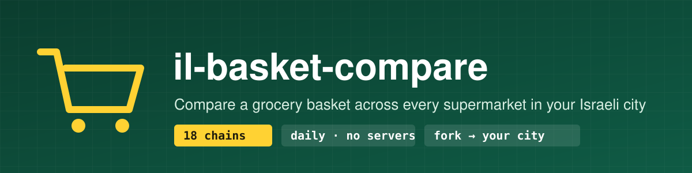
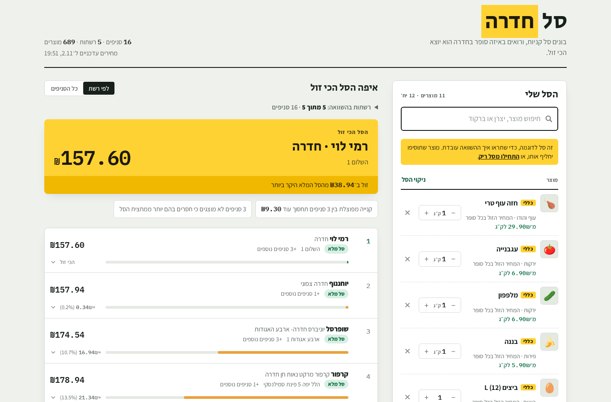
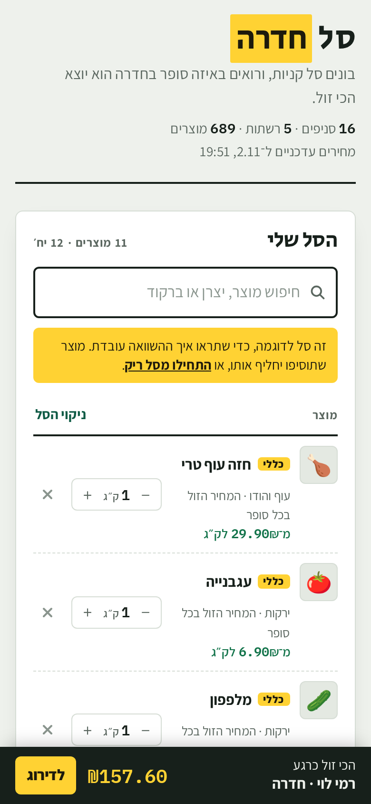

<div dir="rtl">

<p align="center"></p>

<p align="center">
  <a href="https://github.com/Shtibel1/il-basket-compare/actions/workflows/ci.yml"></a>
  <a href="LICENSE"></a>
  <a href="README.md"></a>
</p>

# il-basket-compare

### 🛒 להשתמש עכשיו: **[shtibel1.github.io/il-basket-compare](https://shtibel1.github.io/il-basket-compare/)**

מקלידים את שם העיר (או לוחצים "השתמשו במיקום שלי") ומשווים את הסל בכל סניפי הסופרמרקטים באזור. אתר אחד חינמי לכל הארץ שמתעדכן כל יום, בלי להוריד ובלי לשנות כלום. אפשר לשתף עיר ישירות עם `?city=<סמל יישוב>`, למשל [`?city=7400`](https://shtibel1.github.io/il-basket-compare/?city=7400) לנתניה.

זה גם תבנית לאתר השוואת מחירי סל קניות לכל עיר בישראל. בונים סל ורואים באיזה סופר בעיר הוא יוצא הכי זול. המחירים מגיעים מקובצי המחירים שהרשתות הגדולות חייבות לפרסם לפי חוק שקיפות המחירים. ריצה יומית של GitHub Actions מורידה אותם, והאתר מתארח ב-GitHub Pages, בלי שרתים, בלי מסד נתונים ובלי מפתחות.

<p align="center">
  
  
</p>

## מה יש

- 18 רשתות דרך 4 פורטלים: שופרסל, קרפור, רמי לוי, יוחננוף, אושר עד, טיב טעם ועוד.
- השוואה לפי ברקוד למוצרים ארוזים, והשוואה לפי שם לעוף, בשר, פירות וירקות (בכל סופר נלקח הפריט המתאים הזול ביותר).
- מבצעים שפתוחים לכל הלקוחות, בלי מבצעי מועדון, אשראי וקופונים.
- דירוג לפי רשת או לפי סניף, פירוט סל, מצב כהה ותמיכה מלאה בנייד.
- הכול מוגדר בקובץ אחד, `site.config.json`: עיר, רשתות ומיתוג.
- אשף התקנה, `python -m pricecompare init`, שמוצא את סמל היישוב של הלמ״ס ואת הסניפים של כל רשת.

## מצב ארצי (האתר המתארח)

הריפו הזה מפרסם אתר אחד לכל הערים. הריצה היומית מפעילה את `python -m pricecompare national`: היא מורידה פעם אחת את רשימות הסניפים ואת קובצי המחירים והמבצעים של כל הרשתות, משייכת כל סניף ליישוב לפי סמל היישוב של הלמ״ס (או לפי שם היישוב בשם הסניף או בכתובת), וכותבת קובץ לכל עיר, `data/cities/<סמל>.json`, ואינדקס, `data/index.json`, עם הערים והקואורדינטות שלהן.

החיפוש בדף עובר על כל היישובים בישראל (`pricecompare/settlements.json`, קובץ סטטי עם קואורדינטות). "המיקום שלי" ממפה את המיקום ליישוב הקרוב, ויישוב בלי סניפים פותח את העיר הקרובה ביותר שיש בה סניפים בטווח 15 ק״מ. העיר שנבחרה נשמרת בדפדפן, ואפשר להחליף אותה. כדי לשמור על גודל האתר, כל קובץ עיר מכיל את 25,000 המוצרים שנמכרים בהכי הרבה סניפים בעיר, ואת כל המוצרים הכלליים (ירקות, עוף וכו').

ריפו שנוצר מהתבנית ממשיך לפרסם את העיר שלו. כדי לפרסם אצלכם את האתר הארצי, הגדירו משתנה ריפו `HOSTED=true`.

## התחלה מהירה (אתר לעיר שלכם)

**בלי להתקין כלום**

1. לוחצים **Use this template** (או Fork).
2. מעדכנים את `site.config.json` לעיר שלכם, או מריצים את האשף מקומית ומעלים את הקובץ שנוצר.
3. ב-**Settings → Pages** בוחרים **Source: GitHub Actions**.
4. ב-**Actions → Update prices and deploy** לוחצים **Run workflow**. האתר עולה בכתובת `https://<you>.github.io/<repo>/` ומתעדכן כל יום.

**מקומית**

```bash
pip install -r requirements.txt
python -m pricecompare init      # למשל: נתניה
python -m pricecompare update    # הורדת המחירים של היום
python -m pricecompare serve     # http://localhost:8000
```

לפני `update`, האתר מציג את נתוני הדוגמה שבריפו (`web/sample-data.json`), כך שאפשר לראות את הממשק גם בלי אינטרנט.

## הוספת רשת או פורטל

- **רשת בפורטל שכבר נתמך**: מוסיפים שורה ל-`CHAINS` בקובץ `pricecompare/chains.py`.
- **פורטל חדש**: מוסיפים מחלקה ב-`pricecompare/sources.py` עם `stores()`, `latest_price_files()` ו-`latest_promo_files()`, רושמים אותה ב-`source_for()` ומוסיפים בדיקה.

## הערה משפטית

המחירים ציבוריים ומתפרסמים לפי חוק לקידום התחרות בענף המזון (שקיפות מחירים), התשע״ד-2014. הפרויקט רק מוריד את הקבצים מהפורטלים הציבוריים של הרשתות, ואינו קשור לאף רשת. המחירים עלולים להתעדכן באיחור או להכיל טעויות, אז כדאי לבדוק בחנות. תמונות מוצרים **כבויות כברירת מחדל**, כי הן מוגנות בזכויות יוצרים ואינן חלק מהמידע שמתפרסם לפי החוק. אם מפעילים `"images": true`, האחריות לוודא שמותר להשתמש במקור התמונות היא עליכם.

## תוכנית המשך

- פורטלים נוספים (ויקטורי, מחסני השוק, חצי חינם)
- כמה ערים באתר אחד, עם בחירת עיר
- היסטוריית מחירים
- קישור לשיתוף סל
- ממשק באנגלית

## רישיון

[MIT](LICENSE) © Nadav Shtibel

</div>
