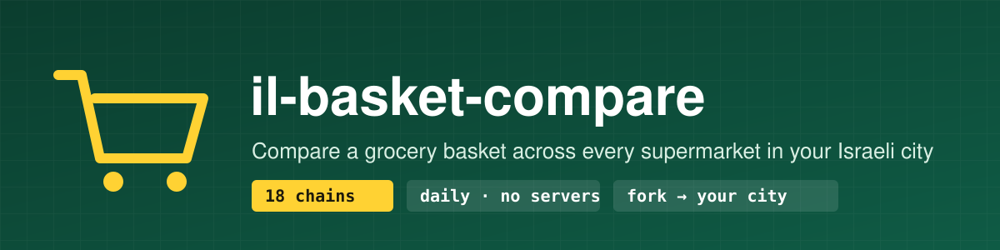
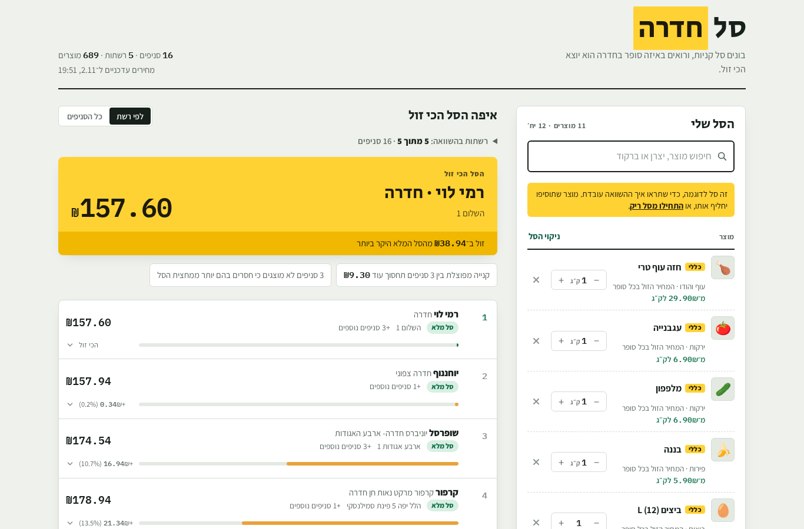
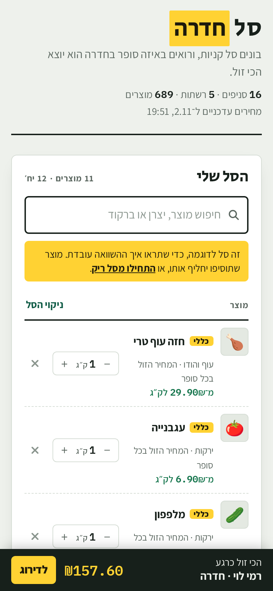
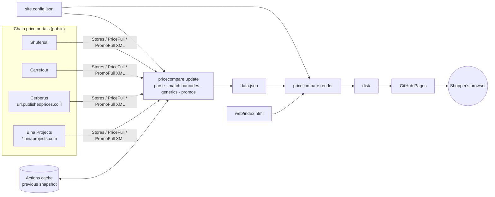

<p align="center"></p>

<p align="center">
  <a href="https://github.com/Shtibel1/il-basket-compare/actions/workflows/ci.yml"></a>
  <a href="LICENSE"></a>
  
  
  
  <a href="README.he.md"></a>
</p>

**il-basket-compare** is a template for a supermarket price-comparison site for any Israeli city. Shoppers build a basket and see which supermarket near them sells it for the least. The data comes from the price files that every large chain must publish under the Price Transparency Law. A daily GitHub Actions job downloads them, and the site is served from GitHub Pages. There are no servers, no database and no API keys.

<p align="center">
  
  
</p>

## Features

- **18 chains, 4 portals**: Shufersal, Carrefour, Rami Levy, Yohananof, Osher Ad, Tiv Taam and more (see [`pricecompare/chains.py`](pricecompare/chains.py)).
- **Exact matching for packaged goods** by barcode, plus **generic matching for fresh produce** by name (chicken breast, tomatoes, eggs): each store's cheapest matching item is used.
- **Promotions open to all customers** (sale price, multi-buy, 1+1). Club, credit-card and coupon deals are excluded.
- **Ranking by chain or by branch**, with missing-item handling, a breakdown per store and a mobile summary bar.
- **One static page**: vanilla JS, Hebrew RTL, dark mode. The basket is saved in `localStorage`.
- **Config-driven**: city, chains and branding live in [`site.config.json`](site.config.json).
- **Setup wizard**: `python -m pricecompare init` finds your city's CBS code and the branches of every chain.

## Quick start

**Option A: GitHub only (about 5 minutes)**

1. Click **Use this template** → *Create a new repository* (or fork it).
2. Edit `site.config.json` for your city, or run the wizard locally (see below) and commit the result.
3. Go to **Settings → Pages → Source: GitHub Actions**.
4. Go to **Actions → Update prices and deploy → Run workflow**. Your site goes live at `https://<you>.github.io/<repo>/` and refreshes every day.

**Option B: locally**

```bash
git clone https://github.com/<you>/<repo> && cd <repo>
pip install -r requirements.txt
python -m pricecompare init            # asks for a city, e.g. נתניה or Netanya
python -m pricecompare update          # downloads today's prices (a few minutes)
python -m pricecompare serve           # http://localhost:8000
```

Before you run `update`, `serve` shows the committed sample data (`web/sample-data.json`), so you can see the UI offline right away.

Example wizard run:

```text
$ python -m pricecompare init --city Netanya --yes
City: נתניה / Netanya (CBS code 7400)
  ✓ שופרסל (shufersal): 11 branches
  ✓ קרפור (carrefour): 7 branches
  ✓ רמי לוי (ramilevy): 5 branches
  ...
Wrote site.config.json: 13 chains, 42 branches.
```

## Configuration

```jsonc
{
  "region": {
    "name": "חדרה",                 // shown in the UI
    "name_en": "Hadera",
    "city_codes": ["6500"],         // CBS locality codes (סמל יישוב)
    "names": ["חדרה", "גבעת אולגה"]  // fallback text match for chains that leave the code empty
  },
  "chains": ["shufersal", "ramilevy"], // or "all"
  "branding": {
    "title_prefix": "סל", "title_highlight": "חדרה",
    "tagline": "…", "logo": "", "favicon": "",
    "storage_prefix": "hadera",       // localStorage key prefix
    "colors": { "--accent": "#0f5b45", "--tag": "#ffd233" },
    "colors_dark": {}
  },
  "images": false                     // product photos, off by default (see Legal)
}
```

`python -m pricecompare render` fills the branding into `web/index.html` and writes the finished site to `dist/`. Every CSS variable in the page (`--accent`, `--tag`, `--ground`, …) can be overridden.

## Architecture



| Module | Job |
| --- | --- |
| `pricecompare/chains.py` | Registry of supported chains and their portal settings |
| `pricecompare/sources.py` | One downloader per portal |
| `pricecompare/parse.py` | Store and price XML parsing, region matching |
| `pricecompare/generic.py` | Name rules for fresh produce |
| `pricecompare/promos.py` | Promotions that are open to everyone |
| `pricecompare/build.py` | Builds the compact `data.json` |
| `pricecompare/site.py` | Renders the branded static site |
| `pricecompare/wizard.py` | The `init` setup wizard |

## Adding a chain or a portal

- **A chain on a supported portal**: add one line to `CHAINS` in [`pricecompare/chains.py`](pricecompare/chains.py). For Cerberus that is the public username; for Bina, the subdomain prefix and chain ID. Then run `python -m pricecompare init` again to check that it finds branches.
- **A new portal**: add a class to [`pricecompare/sources.py`](pricecompare/sources.py) with `stores()`, `latest_price_files(ids)` and `latest_promo_files(ids)`, register it in `source_for()`, and add a test with a recorded sample file.

## Legal note about the data

The prices are public: under the Promotion of Competition in the Food Sector Law (Price Transparency), 2014, large chains must publish their prices for every branch. This project only downloads those files from the chains' own public portals. It is not affiliated with any chain, and the prices may be late or wrong, so always check in the store. Product photos are **off by default** because they are copyrighted and are not part of the published data. If you turn on `"images": true`, it is your responsibility to make sure you are allowed to use the image source.

## Roadmap

- [ ] More portals (Victory, Mahsaney Hashuk, Hazi Hinam)
- [ ] Several cities in one deployment, with a city picker
- [ ] Price history and "cheapest day" trends
- [ ] Sharable basket links
- [ ] English UI option
- [ ] PWA / offline mode

## Contributing

PRs are welcome. See [CONTRIBUTING.md](CONTRIBUTING.md).

## License

[MIT](LICENSE) © Nadav Shtibel
